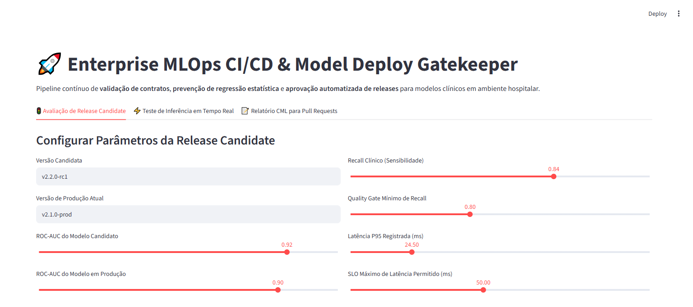

# 🚀 Enterprise MLOps CI/CD & Model Deploy Gatekeeper

[](https://www.python.org/downloads/)
[](https://github.com/features/actions)
[](https://docs.pydantic.dev/)
[](#)
[](#)
[](#)

Pipeline contínuo de **validação de contratos**, **prevenção de regressão estatística** e **aprovação automatizada de releases** para modelos clínicos em ambiente hospitalar.

---

## 📸 Validação Visual de Execução (Playwright E2E)

### Painel Executivo do Gatekeeper de Deploy & Avaliação de Release


---

## 🎯 Por que CI/CD Específico para Machine Learning?

Diferente do software convencional, modelos preditivos falham silenciosamente:
1. **Regressão de Sensibilidade**: Um novo modelo pode ter ROC-AUC maior, mas deixar passar casos graves de sepse por perda de sensibilidade.
2. **Violação de SLO de Latência**: Modelos ensemble mais pesados podem exceder a tolerância máxima de 50ms necessária para integração em prontuário eletrônico.
3. **Quebra de Contrato de Dados**: Adição ou remoção de features sem versionamento derruba endpoints REST em tempo real.

Este repositório estabelece uma esteira de **Continuous Machine Learning (CML)** com **GitHub Actions** que bloqueia o merge caso qualquer limiar clínico ou operacional seja violado.

---

## 🏛️ Estrutura do Projeto (CRISP-DM + SDD)

```
automated-ci-cd-model-deploy/
├── .github/
│   └── workflows/
│       └── ci.yml                    # Pipeline GitHub Actions (lint, test, build)
├── SPEC.md                           # Especificação de contratos Pydantic
├── crisp_dm/
│   └── 06_deployment.md              # Governança de deploy segundo CRISP-DM
├── src/
│   ├── schemas.py                    # Schemas Pydantic para inferência e gates
│   ├── validator.py                  # Motor validador e simulador de inferência
│   └── app.py                        # Dashboard Streamlit de controle de releases
├── tests/
│   └── unit/
│       └── test_validator.py         # Testes de regressão e validação com PyTest
├── docs/
│   └── screenshots/                  # Evidências Playwright E2E
├── Dockerfile                        # Imagem de container de inferência
└── requirements.txt                  # Dependências fixadas
```

---

## 🧪 Barreiras de Qualidade (Quality Gates)

| Barreira de Qualidade | Regra Contratual | Ação em Caso de Violação |
| :--- | :--- | :--- |
| **Queda Máxima de AUC** | $\Delta AUC \ge -0.015$ | 🛑 Bloqueio imediato do PR |
| **Recall Clínico Mínimo** | $\ge 80.0\%$ | 🛑 Bloqueio imediato do PR |
| **Latência P95 (SLO)** | $\le 50.0\text{ ms}$ | 🛑 Bloqueio imediato do PR |
| **Contrato Pydantic** | Validação estrita de tipos e limites | 🛑 Falha no teste unitário |

---

## 🚀 Como Executar Localmente

### 1. Clonar o repositório
```bash
git clone https://github.com/generozo-paulo/automated-ci-cd-model-deploy.git
cd automated-ci-cd-model-deploy
```

### 2. Instalar dependências
```bash
pip install -r requirements.txt
```

### 3. Rodar a bateria de testes de CI/CD
```bash
python -m pytest tests/unit/ -v
```

### 4. Executar o Painel Gatekeeper
```bash
python -m streamlit run src/app.py
```
Acesse em: `http://localhost:8501`

---

## 🐳 Execução via Docker

```bash
docker build -t clinical-model-inference:latest .
docker run -p 8501:8501 clinical-model-inference:latest
```

---

## 👨‍💻 Autor

**Paulo Generozo**
- GitHub: [@generozo-paulo](https://github.com/generozo-paulo)
- Especialização: Machine Learning & MLOps em Saúde
